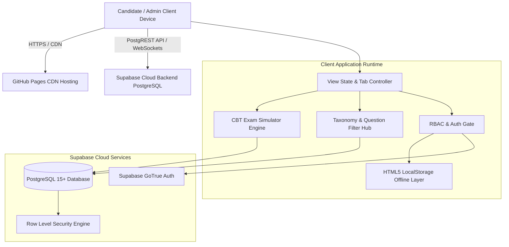

# 🏛️ CBLR Rule 6 Exam Preparation Portal — Technical Handover & Engineering Architecture Document

> **Confidential & Proprietary**  
> **Author & Project Owner:** Dhruv Gori  
> **Intended Audience:** Software Engineers, Full-Stack Developers, DevOps Engineers, and System Architects  
> **Current Version:** v3.4 (Production / Live)  
> **Date of Handover:** November 2026  

---

## 📑 Table of Contents
1. [Executive Summary & Purpose](#1-executive-summary--purpose)
2. [High-Level System Architecture](#2-high-level-system-architecture)
3. [Technology Stack & Design Decisions](#3-technology-stack--design-decisions)
4. [Repository Structure & File Inventory](#4-repository-structure--file-inventory)
5. [Database Architecture & Data Models (Supabase / PostgreSQL)](#5-database-architecture--data-models-supabase--postgresql)
6. [Authentication, Authorization & Role-Based Access Control (RBAC)](#6-authentication-authorization--role-based-access-control-rbac)
7. [Front-End Subsystems & Component Lifecycle](#7-front-end-subsystems--component-lifecycle)
8. [Hosting, CI/CD Pipeline & Deployment Strategy](#8-hosting-cicd-pipeline--deployment-strategy)
9. [Operational Runbooks & Common Maintenance Tasks](#9-operational-runbooks--common-maintenance-tasks)
10. [Future Engineering Roadmap & Recommendations](#10-future-engineering-roadmap--recommendations)

---

## 1. Executive Summary & Purpose

The **CBLR Rule 6 Exam Preparation Portal** is a mission-critical, full-featured Computer-Based Test (CBT) simulation platform designed specifically for aspirants appearing for the **Customs Brokers Licensing Regulations (CBLR), 2018 — Regulation 6(7)** written examination conducted by the National Academy of Customs, Indirect Taxes and Narcotics (NACIN) / Central Board of Indirect Taxes and Customs (CBIC).

### Primary Objectives
- Provide an authentic, high-fidelity replica of the real NACIN CBT examination interface with official negative marking (-1 for wrong, +3 for correct, 150 questions in 150 minutes).
- Host an exhaustive master repository of **1,271 verified statutory questions** categorized across 23 Acts/Rules, 119 Chapters, and specific book sources (e.g., *Licensed to Clear*).
- Serve as a comprehensive legal hub featuring 30+ Partner Government Agencies (PGAs) / Allied Acts and a community statutory study material repository.
- Support **cross-device authentication and roster management** through Supabase cloud sync while remaining 100% resilient offline via browser `localStorage`.

---

## 2. High-Level System Architecture

The project employs a modern **hybrid serverless single-page application (SPA)** architecture:



### Architectural Highlights
- **Zero-Build Architecture**: The front-end is written in native HTML5, modern CSS3 (Custom Properties), and vanilla JavaScript (ES6+), requiring **no bundler (Node/Webpack/Vite)**. Any engineer can run, test, and deploy immediately without managing brittle `npm` dependencies.
- **Dual-State Storage**: The application operates seamlessly in **Cloud-Connected Mode** (real-time sync to Supabase) and **Local Demo / Offline Mode** (`localStorage`), ensuring candidates can practice uninterrupted even in low-bandwidth or offline environments.
- **Sub-Millisecond Auth**: Authentication checks perform an instant local registry evaluation before falling back to network queries, eliminating loading spinners for regular examinees.

---

## 3. Technology Stack & Design Decisions

| Layer | Technology | Rationale / Engineering Decision |
| :--- | :--- | :--- |
| **Front-End Core** | Pure HTML5 / CSS3 / Vanilla JS (ES6+) | Instant loading, zero build steps, ultra-low bundle size, long-term maintainability without framework churn. |
| **PWA & Mobile** | Web App Manifest, Service Workers, Touch Icons | Enables full-screen installation on iOS Safari and Android Chrome as a native-like app. |
| **Spreadsheet Parser**| SheetJS (`xlsx.full.min.js` v0.18.5 via CDN) | Allows administrators to batch-import questions directly from Excel spreadsheets into the portal. |
| **Cloud Backend** | Supabase (PostgreSQL 15+, PostgREST, GoTrue) | Open-source Firebase alternative providing auto-generated REST APIs, Auth, and native SQL triggers. |
| **Hosting & CDN** | GitHub Pages (`https://goridhruv-ops.github.io/cblr-rule6-exam-demo/`) | Free, distributed global CDN hosting with automatic Git-triggered deployments. |
| **Version Control** | Git & GitHub (`goridhruv-ops/cblr-rule6-exam-demo`) | Standard Git branching model with direct production tracking on the `main` branch. |

---

## 4. Repository Structure & File Inventory

The repository is structured cleanly with minimal overhead:

```
.
├── index.html                           # The core application (1.5 MB, single-file SPA)
│                                        # Contains all HTML views, CSS design system,
│                                        # and 1,271 pre-bundled master seed questions.
├── manifest.json                        # Progressive Web App (PWA) configuration
├── logo.svg                             # Golden Scales & Anchor official emblem (Vector)
├── apple-touch-icon.png                 # iOS Safari Home Screen icon (180x180 px)
├── icon-192.png                         # Android PWA launcher icon (192x192 px)
├── icon-512.png                         # High-res splash / launcher icon (512x512 px)
├── favicon.ico                          # Multi-resolution browser tab favicon
│
├── supabase_schema.sql                  # Complete PostgreSQL table definitions, RLS policies,
│                                        # and helper functions for database deployment.
├── seed_questions_all_1271.sql          # SQL batch insert script for all 1,271 questions.
├── questions_bank_all_1271.json         # Raw JSON format of the 1,271 master questions.
├── CBLR_1271_Master_Question_Bank.xlsx  # Master Excel workbook with verified answers and explanations.
│
├── Exam Portal/                         # Legacy prototype standalone exam simulations
│   ├── cblr_mock_exam.html
│   ├── cblr_mock_exam-1.html to 6.html
│
└── README.md                            # High-level overview and statutory syllabus documentation
```

---

## 5. Database Architecture & Data Models (Supabase / PostgreSQL)

The backend schema lives in the `public` schema of PostgreSQL. All tables are protected by **Row Level Security (RLS)**.

### 5.1 Tables Definition

#### 1. `public.access_requests`
Tracks prospective examinee registrations and approvals across devices.
```sql
CREATE TABLE IF NOT EXISTS public.access_requests (
    id UUID PRIMARY KEY DEFAULT gen_random_uuid(),
    user_id_alias TEXT UNIQUE NOT NULL,      -- Desired login ID (e.g. adv_kunal)
    full_name TEXT NOT NULL,                 -- Examinee's full legal name
    phone TEXT,                              -- Contact number
    password_hash TEXT,                      -- Examinee password
    status TEXT NOT NULL DEFAULT 'pending'   -- 'pending' | 'approved' | 'rejected'
        CHECK (status IN ('pending', 'approved', 'rejected')),
    role TEXT NOT NULL DEFAULT 'user'        -- 'user' | 'admin'
        CHECK (role IN ('user', 'admin')),
    created_at TIMESTAMPTZ DEFAULT NOW(),
    reviewed_at TIMESTAMPTZ,
    reviewed_by UUID REFERENCES auth.users(id)
);
```

#### 2. `public.profiles`
Stores extended user profile metadata.
```sql
CREATE TABLE IF NOT EXISTS public.profiles (
    id UUID REFERENCES auth.users(id) ON DELETE CASCADE PRIMARY KEY,
    email TEXT UNIQUE NOT NULL,
    full_name TEXT,
    role TEXT NOT NULL DEFAULT 'user' CHECK (role IN ('user', 'admin')),
    created_at TIMESTAMPTZ DEFAULT NOW()
);
```

#### 3. `public.questions`
Centralized statutory question bank.
```sql
CREATE TABLE IF NOT EXISTS public.questions (
    id TEXT PRIMARY KEY,                     -- Alphanumeric ID (e.g. q-1001)
    act TEXT NOT NULL,                       -- Primary statute (Customs Act 1962, etc.)
    chapter TEXT NOT NULL,                   -- Chapter code & name
    section TEXT DEFAULT 'General',          -- Bare act section reference
    text TEXT NOT NULL,                      -- Question stem
    options JSONB NOT NULL,                  -- Array of 4 string options: ["A", "B", "C", "D"]
    correct INTEGER NOT NULL,                -- 0-indexed correct option (0=A, 1=B, 2=C, 3=D)
    explain TEXT,                            -- Detailed statutory explanation & citation
    book_source TEXT DEFAULT 'General',      -- Source book (e.g. 'Licensed to Clear')
    created_at TIMESTAMPTZ DEFAULT NOW(),
    created_by UUID REFERENCES auth.users(id) ON DELETE SET NULL
);
```

#### 4. `public.exam_attempts`
Logs completed mock exam attempts and score breakdowns.
```sql
CREATE TABLE IF NOT EXISTS public.exam_attempts (
    id UUID PRIMARY KEY DEFAULT gen_random_uuid(),
    user_id UUID REFERENCES auth.users(id) ON DELETE CASCADE,
    user_email TEXT,
    date TIMESTAMPTZ DEFAULT NOW(),
    mode TEXT NOT NULL,                      -- 'full_mock', 'custom_drill', etc.
    neg_mode TEXT NOT NULL,                  -- 'official' (-1) or 'zero'
    total_q INTEGER NOT NULL,
    correct INTEGER NOT NULL,
    wrong INTEGER NOT NULL,
    skipped INTEGER NOT NULL,
    raw_score NUMERIC NOT NULL,
    max_score NUMERIC NOT NULL,
    pass_mark NUMERIC NOT NULL,
    passed BOOLEAN NOT NULL,
    filter_used JSONB,
    per_topic JSONB,
    created_at TIMESTAMPTZ DEFAULT NOW()
);
```

#### 5. `public.study_materials`
Shared statutory bare acts, circulars, and community resource links.
```sql
CREATE TABLE IF NOT EXISTS public.study_materials (
    id TEXT PRIMARY KEY,
    title TEXT NOT NULL,
    category TEXT NOT NULL,                  -- 'Customs Act 1962', 'CBLR 2018', etc.
    url TEXT NOT NULL,                       -- External URL or local data-URI
    description TEXT,
    contributor TEXT DEFAULT 'Contributor',
    type TEXT DEFAULT 'link',                -- 'link' or 'file'
    file_format TEXT,
    file_size TEXT,
    created_at TIMESTAMPTZ DEFAULT NOW(),
    created_by UUID REFERENCES auth.users(id) ON DELETE SET NULL
);
```

---

## 6. Authentication, Authorization & Role-Based Access Control (RBAC)

### 6.1 User Roles
1. **👑 Administrator (`admin`)**:
   - Access to the **👑 Admin Console** tab.
   - Ability to directly provision accounts via **➕ Add Examinee Directly**.
   - Ability to approve or decline pending access requests.
   - Ability to permanently delete users and their exam records.
   - Ability to upload Excel spreadsheets to expand the central question repository.
   - Ability to upload official PDF documents to the study material repository.
2. **👤 Examinee (`user`)**:
   - Access to Mock Exams, Practice Drills, Allied Acts Hub, and Personal Exam History.
   - Can submit study material links (strictly cannot upload raw binary files).
   - Only views their own past examination attempts.

### 6.2 Pre-Configured Seed Users
The application pre-seeds the following master accounts:
- **Root Admin**: `admin` / `admin123` (or via email `goridhruv1@gmail.com`)
- **Examinee Prem**: `prem` / `password123`
- **Candidate Demo**: `candidate_demo` / `candidate123`

### 6.3 Authentication Flow
1. **User Enters Credentials** on the login gate.
2. **Local Registry Check**: If the account exists in browser cache, login is instantaneous.
3. **Cloud Sync Fallback**: If not found locally, the app queries `access_requests` in Supabase with a 2.5-second fail-safe timeout.
4. **Session Persistence**: Active user tokens and profile objects are stored in `localStorage` under `cblr_portal_session_v3`.

---

## 7. Front-End Subsystems & Component Lifecycle

The entire single-page application is orchestrated within an Immediately Invoked Function Expression (IIFE) in `index.html`.

### 7.1 Primary Navigation Tabs
1. **🎯 Exam Setup (`#setupTab`)**: Mode selection (Official 150Q Mock vs. Custom Practice), question count picker, negative marking toggle, book source filter (*Licensed to Clear*, etc.), and 1-click quick-launch presets.
2. **📝 Question Bank (`#bankTab`)**: Searchable, filterable repository of 1,271 questions with bookmarking and instant statutory answer reveals.
3. **🏛️ Allied Acts Hub (`#alliedTab`)**: Interactive statutory matrix of 30+ Partner Government Agencies (DGFT, FSSAI, CDSCO, Legal Metrology, WCCB, etc.) with Customs confiscation and penalty links.
4. **📊 Exam History (`#historyTab`)**: Detailed attempt records, scorecards, topic-wise diagnostic accuracy, and mistake analysis.
5. **📚 Study Material (`#materialsTab`)**: Official bare act repository and community study link sharing.
6. **👑 Admin Console (`#adminTab`)**: System health, candidate rosters, pending requests, question repository batch uploader, and Supabase cloud settings.

### 7.2 The CBT Exam Simulator Engine
- Implements an authentic computer-based test interface with a top status bar, question palette (Answered, Marked for Review, Unattempted), countdown timer, on-screen customs duty calculator, and keyboard shortcuts (`1-4` for options, `ArrowRight`/`ArrowLeft` for navigation, `M` to mark).
- Prevents accidental tab closures via `beforeunload` event protection during active mocks.

---

## 8. Hosting, CI/CD Pipeline & Deployment Strategy

### 8.1 Live Production Environment
- **Live URL:** [https://goridhruv-ops.github.io/cblr-rule6-exam-demo/](https://goridhruv-ops.github.io/cblr-rule6-exam-demo/)
- **GitHub Repository:** `https://github.com/goridhruv-ops/cblr-rule6-exam-demo.git`
- **Deployment Branch:** `main` (tracked by GitHub Pages automatic static builder)

### 8.2 Deployment Workflow
Any change made to `index.html` is deployed to production via standard Git push:
```bash
# 1. Verify code syntax locally using JavaScriptCore
/System/Library/Frameworks/JavaScriptCore.framework/Versions/Current/Helpers/jsc index.html

# 2. Stage, commit, and push
git add index.html
git commit -m "Description of changes"
git push origin main
```
*GitHub Pages rebuilds and deploys the update to its global CDN within 30 to 60 seconds.*

---

## 9. Operational Runbooks & Common Maintenance Tasks

### 9.1 How to Unpause or Reconnect the Supabase Database
Supabase free-tier projects automatically pause after 7 days of inactivity.
1. Log into [supabase.com/dashboard](https://supabase.com/dashboard).
2. If paused, click **"Restore project"** (takes ~2 minutes).
3. If creating a brand new project:
   - Navigate to **SQL Editor** $\rightarrow$ execute the SQL script in `supabase_schema.sql`.
   - Copy the new **Project URL** and **`anon` public key** from **Project Settings $\rightarrow$ API**.
   - In `index.html`, update the constants:
     ```javascript
     const DEFAULT_SUPABASE_URL = "https://your-new-id.supabase.co";
     const DEFAULT_SUPABASE_ANON_KEY = "sb_publishable_your_key...";
     ```

### 9.2 How to Batch Import New Questions via Excel
Administrators do not need to write SQL queries to add questions:
1. Prepare an Excel file (`.xlsx`) with columns:
   `Act`, `Chapter`, `Section`, `Question`, `Option A`, `Option B`, `Option C`, `Option D`, `Correct Option (A/B/C/D)`, `Explanation`, `Book Source`.
2. Sign in as Admin $\rightarrow$ Go to **Question Bank** tab.
3. Drag and drop the Excel file into the **"Upload Questions via Excel"** drop zone.
4. The parser validates taxonomy, assigns unique IDs, updates local storage, and syncs to Supabase.

---

## 10. Future Engineering Roadmap & Recommendations

For the incoming engineer taking over this project, the following architectural enhancements are recommended:

1. **Modularize into TypeScript & Component Framework (Optional)**:
   - While the current single-file architecture guarantees zero-build simplicity, as the team grows, decomposing `index.html` into a Next.js or Vite + React SPA will facilitate multi-developer collaboration.
2. **Automated Supabase Keep-Alive Ping**:
   - Set up a free GitHub Actions workflow on a scheduled cron (`0 0 */3 * *`) that sends a single lightweight HTTP GET request to the Supabase REST endpoint to keep the free-tier database perpetually warm and unpaused.
3. **Candidate Analytics & Weak-Area Drill Engine**:
   - Build automated recommendation algorithms that analyze past exam attempts and auto-generate 20-question targeted drills based on topics where the candidate scored below 50%.
4. **Push Notifications for Admin Approvals**:
   - Integrate a Webhook / Telegram Bot / Resend Email notification triggered by new rows in `access_requests` so administrators receive instant phone alerts when an examinee submits an access request.

---
*Document prepared for engineering handover. All intellectual property, question repositories, and administrative rights belong to Dhruv Gori.*
